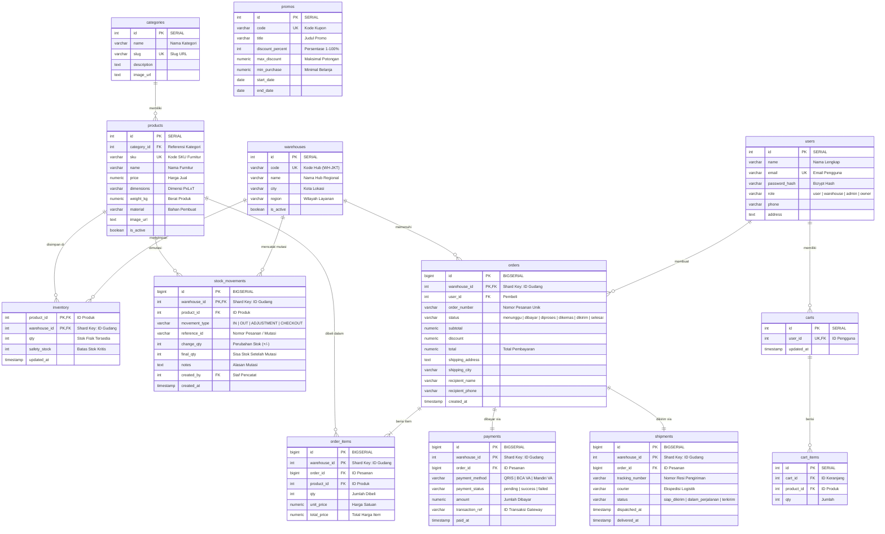

# Entity Relationship Diagram (ERD) & Skema Terdistribusi

Dokumen ini memuat diagram hubungan antar-entitas (ERD) lengkap dalam format Mermaid, klasifikasi tabel berdasarkan model distribusi Citus, serta aturan kunci komposit pada basis data terdistribusi.

---

## 1. Diagram ERD (Mermaid)



---

## 2. Klasifikasi Model Tabel Citus

| Kategori Tabel | Nama Tabel | Mekanisme Distribusi | Alasan Pemilihan |
|---|---|---|---|
| **Reference Tables** | `categories`, `products`, `warehouses`, `promos`, `users` | Direplikasi penuh ke semua node (Coordinator + seluruh Worker) | Ukuran data relatif moderat, read-heavy, dan sering di-JOIN dengan tabel transaksi. Menyediakan join lokal instan tanpa network hop. |
| **Distributed Tables (Colocated)** | `orders`, `order_items`, `inventory`, `payments`, `shipments`, `stock_movements` | Sharded secara horizontal dengan kolom distribusi `warehouse_id` (Colocation Group ID: 2) | Data bervolume tinggi dan berbasis regional. Menempatkan pesanan, item, pembayaran, dan stok dalam shard yang sama pada worker terkait. |
| **Coordinator Tables** | `carts`, `cart_items` | Tabel standar PostgreSQL di Coordinator | Menyimpan state keranjang sementara sesi aktif pembeli sebelum gudang pengirim ditentukan saat checkout. |

---

## 3. Aturan Kunci Komposit (Composite Primary Key) Citus

Dalam arsitektur basis data terdistribusi Citus Data:
> **"Primary key dan Unique Constraint pada tabel terdistribusi WAJIB menyertakan kolom distribusi (shard key)."**

### Contoh Penerapan:
- Pada tabel `orders`, Primary Key didefinisikan sebagai:
  ```sql
  PRIMARY KEY (id, warehouse_id)
  ```
- Pada relasi `order_items`:
  ```sql
  PRIMARY KEY (id, warehouse_id),
  FOREIGN KEY (order_id, warehouse_id) REFERENCES orders(id, warehouse_id) ON DELETE CASCADE
  ```
- Pada relasi `inventory`:
  ```sql
  PRIMARY KEY (product_id, warehouse_id)
  ```

Hal ini diperlukan karena setiap worker memvalidasi constraint integritas data secara independen pada shard lokal miliknya tanpa harus melakukan sinkronisasi inter-node yang lambat.
